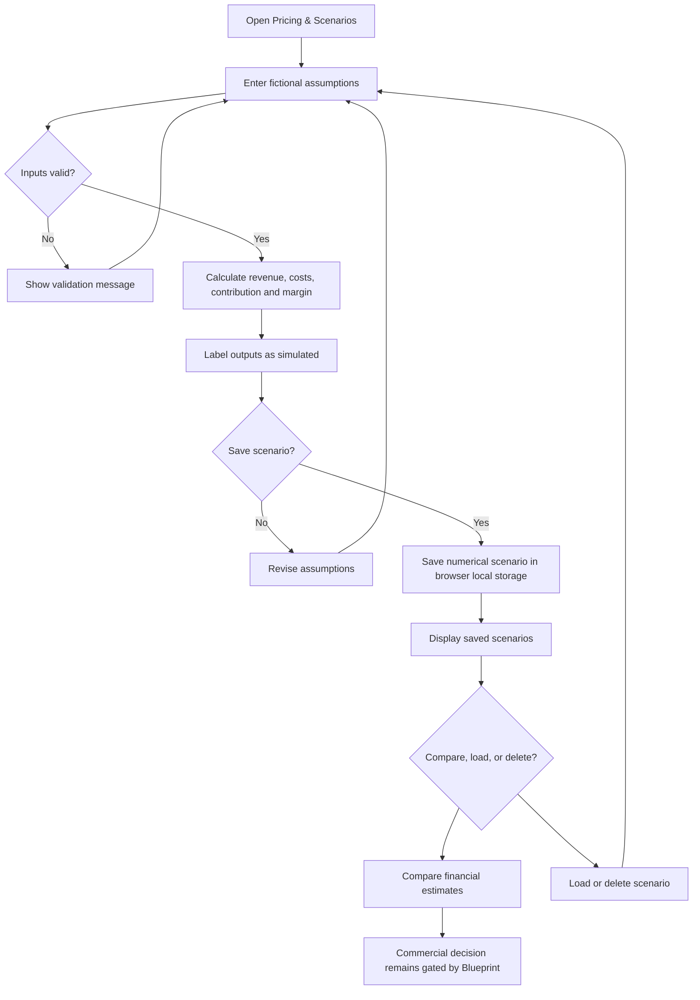
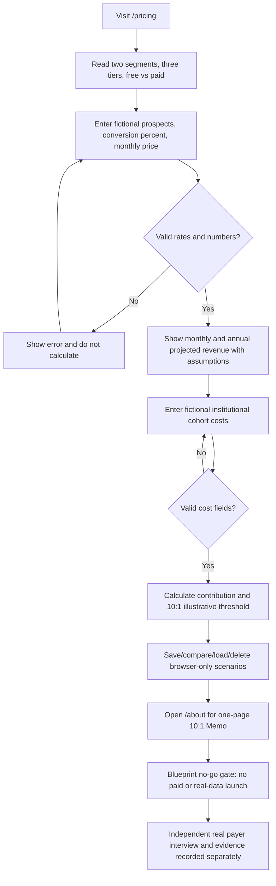
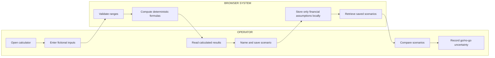
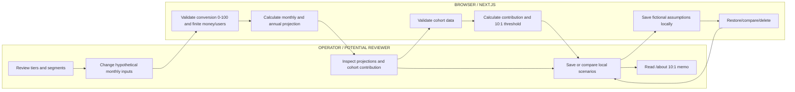

# WEEK 14 — FIRST-PROOF — SHIP PACKET (BEFORE CODE)

**Student:** Sofía López Carvajal · **Role:** OPERATOR · **Venture:** FIRST-PROOF · **Module:** Pricing — The Number That Tells the Truth · **Status:** proposed implementation packet, not evidence of deployment or testing.

## 1. Problem in my words
FIRST-PROOF organizes self-reported assessment records, but we still cannot defend a commercial price. A MXN 1,700 institutional cohort proposal, MXN 1,000 assumed direct cost, and MXN 700 theoretical contribution are assumptions rather than market results. Before asking organizations to pay, I need a transparent way to change assumptions, see the financial consequences, save and compare simulated scenarios, and expose when a price is unsupported. The tool must never imply that an estimated margin proves demand, safety or verified skills.

## 2. Exact user
The primary user of this slice is **Sofía, the student OPERATOR preparing FIRST-PROOF's internal pricing decision**. A secondary reviewer is another Team 4 member checking the model. This is **not** an institutional admin console and **not** a tool collecting actual student/applicant records.

## 3A. Exact Week 14 Crystal Ball Brief requirements and reconciliation
The professor's Week 14 Crystal Ball Brief requires: **a live `/pricing` page with 2–3 tiers and two customer segments, a deliberate free/paid boundary; a revenue simulator (users, conversion, price) producing monthly and annual projections; a one-page 10:1 Memo on `/about`; and one real pricing conversation with a potential payer**. The original cohort calculator alone does NOT satisfy these requirements. These additions expand the prepared implementation slice but do **not** authorize real payments, personal data, or institutional reporting. The memo and simulator must prominently distinguish assumptions from observed evidence. The one genuine potential-customer conversation is a required **external research action**, not an application feature, and remains pending until documented honestly.

### Proposed pricing tiers — fictional, not offers or proven willingness to pay
Two customer segments: **individual students** and **universities/educational organizations**. Three illustrative tiers (all MXN; users can see terms and scope without creating accounts):

| Tier | Segment | Illustrative price | Free/paid boundary and scope |
| --- | --- | --- | --- |
| Free educational organizer | Students | MXN 0/month | Organize self-reported records using the existing app only where security permits; free tooling is a genuine alternative, no credential verification. This pricing page is publicly viewable without student records. |
| Student hypothetical premium | Students | MXN 99/month **hypothesis** | Modeling-only scenario; no checkout, entitlement, unlocked features, or promise of premium functionality. **NOT AVAILABLE FOR PURCHASE**. |
| Institutional cohort pilot | Universities/organizations | MXN 1,700 per cohort of up to 20 participants **hypothesis** | Proposed bounded fictional-data demonstration only, **NOT AVAILABLE FOR PURCHASE**; no dashboards, reports, integration, real-person access or institutional purchase workflow. |

The comparison should also disclose alternative institutional example prices in the revenue simulator only if clearly marked as distinct hypothetical scenarios; do not imply Tier 3 is a monthly recurring subscription. Do not claim verified paid conversion, buyers, price acceptance, or profit. **Free vs paid:** only free informational/sandbox use is in scope; every paid tier is an unvalidated proposal and cannot be purchased. Segment labels and billing units must stay explicit.

## 3. Success definition — before the module closes, X works
At the **live URL**, the OPERATOR can open **Pricing & Scenarios**, enter fictional numbers for cohort participants, cohort revenue, direct costs, acquisition/overhead and support/maintenance, immediately see the calculated contribution, contribution margin, revenue per participant and cost per participant, save at least two named simulated scenarios, reload the page and retrieve them, compare values, and delete them. Invalid/negative inputs are rejected or clearly flagged; the interface states that figures are simulated, not sales, profit, verified benefits or certification. Additionally, `/pricing` visibly presents the **three hypothetical tiers**, both segments, the explicit free/paid and billing-unit boundaries, and an **independent monthly/annual revenue simulator** from users/leads per month, conversion percentage, and recurring price per converted user per month. For the institutional cohort tier, the simulator must label **cohort-based assumptions** separately instead of falsely treating a cohort price as a student subscription. `/about` contains a one-page 10:1 Memo. Links to existing routes must remain intact. The actual test/fix/redeploy evidence will be documented separately.

## 4. IMAGE-GENERATED MOCKUP
See `assets/first-proof-pricing-mockup.png` (concept reference, not a deployed-app screenshot). It shows the ORIGINAL pricing calculator, visible outputs, saved scenarios and prominent limitations. **This original image predates the professor-requirement correction and must not be presented as the final revised UI or a deployed screenshot.** Updated UI reference/acceptance wireframe:

```text
FIRST-PROOF · Pricing & Scenarios · SIMULATED / NOT FOR SALE
[Segment: Students / Organizations]   [Three visible tiers: Free $0 / Student $99 per month / Cohort $1,700 per cohort]
[What is free today vs hypothetical paid proposals]   [Compare with Google Forms/Sheets]
[Revenue simulator: prospects per month | conversion % | monthly price per conversion]
[Monthly conversions | monthly revenue | annual revenue = monthly × 12 | explicit steady-state limitation]
[Cohort calculator: participants | cohort fee | direct/acquisition/support costs]
[Estimated contribution, margin, cost per participant, 10:1 threshold]
[Name / Save / Load / Compare / Delete simulated scenarios, browser-only]
[Link: /about — 10:1 Memo] [Security and evidence warnings]
```

Revise actual interface to satisfy this wireframe. Do not call the original image the new image-generated mockup. If a newly generated image is required for assessment, obtain it as a separate genuine design artifact and date it; do not falsely label a wireframe image-generated.

## 5. Flowchart (Mermaid)


### Updated complete feature flow (Mermaid; supersedes narrow flow above)


## 6. Swimlane: operator and browser system


### Updated actor/system swimlane (Mermaid; supersedes narrow swimlane above)


## 7. Benchmark line — global to Mexico
**Best accessible existing benchmark for this specific spreadsheet-like task:** Google Sheets offers a transparent editable spreadsheet and version history, allowing financial assumptions to be modeled and past versions reviewed. **Our difference/localization:** a narrow MXN-per-cohort FIRST-PROOF interface with ready-to-compare pricing scenarios, built-in formulas, upfront simulation warnings and explicit student-safety/commercial stop gates instead of a general-purpose spreadsheet. This is a usability hypothesis, **not** proof that our version is better. Sources: https://support.google.com/docs/answer/9331169 ; https://support.google.com/docs/answer/9303071 .

## 8. Three-year long view (light charter; three sentences)
If a small pricing calculator proves useful, FIRST-PROOF could become a carefully governed decision workspace for educational evidence workflows and their operational costs. Institutional integrations or real-record reporting would be separate development projects requiring demonstrated user benefit, purchasing commitment, access controls and independent verification. The product must remain honest about the difference between organizing self-reported evidence and independently confirming skills or credentials.

## 9. Scope cut (NOT building)
No live payments, checkout, student account creation, real applicant data, cross-user admin dashboards, institutional reporting, credential validation, automated certifications, AI-generated skill judgments, new Supabase tables, migrations, or institutional integrations. No claim that scenarios stored in this browser synchronize across devices. No assumption that a successful numerical calculator makes the existing record-storage stack production-safe.

## 9A. 10:1 Memo content contract for `/about` (one page)
**Title:** "The 10:1 Memo — what would have to be true". **Today:** a university staff member can use Google Forms or Sheets for required fields and tracking without paying FIRST-PROOF; workflow time, student friction and error risk must be measured in a real comparable process. **Value proposition:** a proposed more guided, evidence-limited workflow to reduce admin rework, but superiority is unproven. **Illustrative fee:** MXN 1,700 per 20-person institutional cohort; **10:1 illustrative gross benefit threshold:** MXN 17,000 per cohort (= fee × 10), equivalently MXN 850/person, before student costs. Illustrative assumptions: MXN 1,000 direct cost → MXN 700 gross contribution (41.2%) before omitted acquisition, maintenance, incident and ongoing labor, so **not profit**. **How to substantiate:** measure staff time saved × defensible loaded wage, prevented costly errors, added student time, and net benefit vs free baseline; ask an actual authorized payer whether they would pay MXN 1,700 and record answer, role, date, exact question and authorization/consent without unnecessary identifiers. **Limitations/decision:** neither 10:1 nor buyer demand has been observed; no claim of verified credentials or operational safety; paid and real-data deployment are NO-GO until Blueprint's buyer, value, sustainability, security and shadow-clause gates are independently met. Keep memo visually one page in normal desktop viewing and printable to one A4/letter page where practical.

## 10. Architecture and free stack
| Layer | Technology | Purpose / caveat |
| --- | --- | --- |
| Existing venture | Next.js 16, React 19, TypeScript, Tailwind CSS | Add a new client-side `/pricing` route inside the existing project, not replace it |
| Calculators | Pure TypeScript formulas | Cohort economics **and** recurring monthly revenue projections; clearly separated billing models |
| UI | React client component + Tailwind | `/pricing`: 3 tiers / 2 segments, simulator, cohort inputs, saved scenarios, warnings; preserve existing routes |
| 10:1 Memo | Existing Next.js App Router `/about` route or safe in-place amendment | One-page memo, preserve existing `/about` content where present; do not overwrite blindly |
| Storage | Browser `localStorage` | Financial assumptions only, **no personal or applicant data**; same-device only |
| Auth and records | Existing Supabase Auth / RLS | This new feature does not claim to fix or verify inherited security; real-data use remains blocked pending independent checks |
| Deployment | GitHub → Vercel | Reuse existing verified project/domain and confirm URL loads |
| Tests | Node built-in test runner or project test setup | Formula, validation, persistence-interface logic and manual UI tests |

### Formulas and limitations
`totalCosts = directCosts + acquisitionOverhead + supportMaintenance`; `contribution = cohortPrice - totalCosts`; `contributionMargin = cohortPrice > 0 ? (contribution/cohortPrice)*100 : null`; `revenuePerParticipant = cohortPrice / participants`. For the monthly recurring simulator: `monthlyConversions = leadsPerMonth * conversionPercent / 100`; `monthlyRevenue = monthlyConversions * pricePerMonth`; `annualRevenue = monthlyRevenue * 12`, assuming **identical monthly acquisition and no churn, refunds, taxes or capacity limits**; this is NOT ARR from a retained subscriber base and NOT a forecast based on verified conversions. Display fractional expected conversions honestly as a model, not fractional actual customers; validate leads/users as integer 0–1,000,000, conversion 0–100, price 0–1,000,000, all finite; currency must be MXN. Institutional cohorts use separate cohort-revenue model (e.g. cohorts/month × MXN/cohort × 12) with correct units, not mixed into monthly per-student subscriptions. Saved scenarios contain both the cohort values and optional recurring-model assumptions only as numeric fictional inputs; support safe migration of previous saved cohort scenarios if needed. Negative contribution is allowed and prominently displayed. Contributions are **not profit**. `10:1 value required = cohortPrice * 10` is a hypothetical classroom benchmark, not proof of actual savings.

## 11. SECURITY FLOOR before coding
1. No secrets/API credentials introduced; use project Vercel environment variables for actual secrets, **never** `NEXT_PUBLIC_` for private keys.
2. Calculator saves **only fictional financial numeric inputs**, not personal data, in localStorage. Existing record screens handling personal info require verified Supabase Auth.
3. Confirm RLS is enabled and user-scoped for **every** relevant real user-data table before using any real records; **not verified by this packet**.
4. Validate the new revenue simulator inputs and cohort numeric inputs (finite numbers, nonnegative prices/costs, integer participants 1–10,000) and scenario names (1–60 characters); do not render untrusted HTML.
5. Never store interview participant identities or discussion transcripts in browser localStorage; record payer conversations separately with consent and minimal information. Avoid any public customer claims based on unsupported interview notes.
6. Demos, tests and seeds use made-up scenarios, visibly labeled **SIMULATED**.
**No real applicant data until the existing app's security controls are actually verified.**

## 12. Test plan — two passes
**Mechanical:** calculate base scenario 20 / 1700 / 1000 / 0 / 0 → contribution 700 and 41.2%; modify support to 300 → contribution 400; set price to 0 → no division by zero; block participants 0, negative cost, nonnumeric input and names >60 characters; save two scenarios; reload and confirm local persistence; delete one; verify browser on mobile and desktop; inspect console; record screenshots. **Bug-fix-redeploy:** document at least one *actual* bug found (even if tests reveal none initially, do not fabricate one), reproduce, correct, rerun and redeploy; log before/after evidence.

**Additional Week 14 checks:** confirm exactly 3 visible tiers, exactly 2 labeled customer segments, prominent free/not-for-sale boundary; conversion 0%, 10%, 100% on 100 leads × MXN 99 gives MXN 0, MXN 990, MXN 9,900 monthly; corresponding annual numbers ×12; reject -1 users, 101% conversion, negative price, non-finite inputs; verify no implicit churn/ARR claims; cohort unit math stays separate; inspect `/about` text and one-page print; confirm existing routes still load, browser persistence does not imply synchronization, no real user records or secrets appear. Perform desktop/mobile, console and accessible-label checks.

**Genuine potential-customer pricing conversation (separate real-world evidence, PENDING):** ask at least one **real potential payer**, ideally an authorized university buyer, “Would you pay MXN 1,700 for a safely scoped 20-person cohort pilot if its value and security were demonstrated?” Record date, participant role (omit name unless necessary and consented), exact question, **actual answer including refusal or uncertainty**, and whether they had buying authority; do not represent intent as actual payment/contract. This cannot be completed by a synthetic ChatGPT persona or fabricated quote. Note that a conditional answer does not satisfy the Blueprint's written buyer commitment gate. Store evidence privately if personal details appear.

**Persona Layer 1:** open a **fresh independent chat**, identify the synthetic persona as synthetic, share *actual screenshots from the deployed product in order* and ask it to attempt the saved-scenario task based only on visible UI. Log confusion verbatim and fix the highest-priority confusion before final redeploy; no invented clicks or user quotes.

## 13. Blueprint conditions and Shadow Clause
The price remains a **hypothesis**, not validated willingness to pay. Compare against free alternatives; do not shift inappropriate work to students. Reject any unsafe data handling, unsupported credential claims, unbuilt institutional capability, or unaffordable maintenance. The appointed technical/security, user-protection, and OPERATOR reviewers must be able to halt real-data deployment if safeguards fail; these roles are **proposed** and not claimed to be appointed.

## 14. Implementation prompt, commits, deploys and close
Implementation agent must add a pricing route, pure cohort and revenue calculators, and `/about` memo; use exact acceptance criteria and tests above. Suggested **minimum five real commits**, sequentially: (1) packet/docs/mockup, (2) pure calculation and revenue tests, (3) pricing tiers, revenue simulator and cohort form UI, (4) saved scenarios + validation and `/about` memo, (5) actual bug fix and documentation. Perform **two real Vercel deploys**, with one after initial implementation and one after real bug fix. After every session update `docs/DECISIONS.md`, write tomorrow's first move, commit and push. Commit/deploy counts remain unverified until GitHub/Vercel history proves them.

## 15. Evidence still required
Actual repository commits; 2 deployment URLs/history entries; live functional URL; test results and genuine bug-fix screenshot; genuine payer interview evidence (or explicitly pending); tier, revenue model and `/about` memo screenshots; independent persona transcript and screenshot-based report; 3:30 demo recording including 30 sec “what changed my mind”; full unedited build chat PDF; verified applicability of Week 14 Crystal Ball Brief on the previous page (not included in this ZIP).
