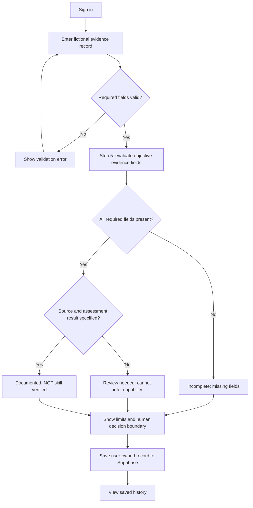
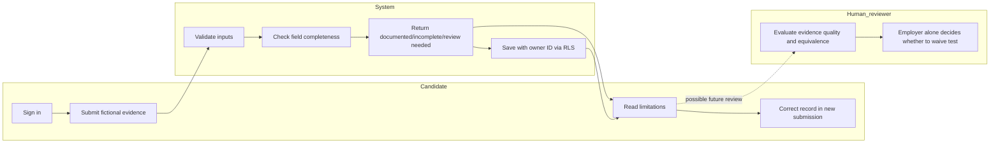

# FIRST-PROOF — WEEK 12 BUILD PACKET v1
**Packet-before-code evidence:** This is the product specification for the Week 12 rebuild; preserve its commit before implementation. **Founder:** Sofia Lopez.

## Problem in my words
Students can encounter repeat baseline skills checks across internship applications, but providing another badge alone may add more work rather than remove a test. FIRST-PROOF must distinguish an administratively documented record from a verified skill and from an employer-authorized waiver. The 10-to-1 substitution is a proposed economic hypothesis, not measured reality.

## Exact first user and week's success
A student applicant who wants to document one baseline skills assessment without falsely claiming employer acceptance. **Before the module closes:** a signed-in user can submit a fictional evidence record with validated fields, see an explicit rule-based result with uncertainty, persist it in Supabase under their own account, and retrieve it on the product page. RLS prevents other users from reading that record.

## Mockup
See `public/first-proof-mockup.png` when generated/placed. **This file is a required image-generation asset; do not claim it exists until created.** Design: left-column assessment entry, right-column evidence result with status and limitations, lower saved-record history. Must include visible `Demo data only` label.

## Mermaid — feature flow

## Mermaid — responsibility swimlane

## Benchmark line
**Existing solution:** TestGorilla provides employer-managed skills assessments for screening (https://www.testgorilla.com/); see its skills assessment guide (https://www.youtube.com/watch?v=Kcda9p46Hc0). **Difference proposed:** FIRST-PROOF tests transparent reusable evidence mapping to a shared baseline and explicitly separates administrative documentation from employer acceptance. No superiority or interoperability is proven.

## Long view (exactly three sentences)
If this small workflow succeeds, FIRST-PROOF could become a candidate-controlled evidence passport for clearly defined baseline assessments. Participating employers might publish accepted assessment equivalencies and confirm actual waivers rather than relying on generic credentials. Over three years the product would track confirmed reductions in duplicated screening while preserving candidate privacy and employer judgment.

## Scope cut
No assessment administration, no automatic competency certification, no recruiting dashboard, no file upload, no scoring candidates, no HR integrations, no employer waiver claims, no AI model pretending to validate truth.

## Architecture and stack
| Layer | Technology | Purpose |
|---|---|---|
| UI | Next.js App Router + React + Tailwind | Home, product, about |
| Auth | Supabase Auth (Google OAuth) | Protect saved candidate records |
| Data | Supabase Postgres + RLS | Persist only owner-accessible records |
| Logic | Pure TypeScript deterministic evaluator | Explicit Step 5 evidence boundary |
| Hosting | Vercel + purchased venture domain | Public live application |
| Repo | GitHub | History, proof of packet-first work and commits |

## Data model
`evidence_records`: `id uuid`, `user_id uuid`, `assessment_type text`, `source_label text`, `assessment_date date`, `evidence_note text`, `status text`, `missing_fields jsonb`, `created_at timestamptz`. RLS: authenticated `auth.uid() = user_id` for select, insert and delete. No other user's personal records displayed.

## Security plan
Use environment variables for Supabase URL/anon key, no service-role key on client or in repository. Require Google login before a record can be saved or read. Configure RLS policies for ownership, client and server-side length/type validation, and visibly fictional data. Do not collect external candidates' information in demonstrations.

## Acceptance tests
1. Unauthenticated visitor sees login requirement; cannot access saved records.
2. Valid fictional record produces a `Documented` administrative result and displays `NOT independently skill-verified`.
3. Missing source, assessment date, or note produces `Incomplete`, with explicit missing fields; system must never turn missing evidence into a negative grade.
4. Values beyond size limits rejected; malformed dates rejected.
5. Saved record persists after reload for signed-in user.
6. Second signed-in user cannot read first user's records (RLS test).
7. Mobile layout legible; `/`, `/product`, `/about` load.
8. After observing an actual bug, document its reproduction, fix, test and redeploy; do not invent a bug.
9. Synthetic persona in a fresh chat sees real screenshots, reports confusion, and the most important confusion is fixed.

## Shadow clause implementation
Never label missing/unaccepted evidence as a failure or negatively classify a person. Always show evidence limitations, correction route (resubmit), and note that employers must make consequential assessment acceptance decisions; no unproven “verified recycled” or other unrelated claims.

## Evidence status
Documentation prepared. Real screenshots, mechanical tests, bug fix, actual commits, deployments, domain purchase, and persona transcript must be appended only when observed.
