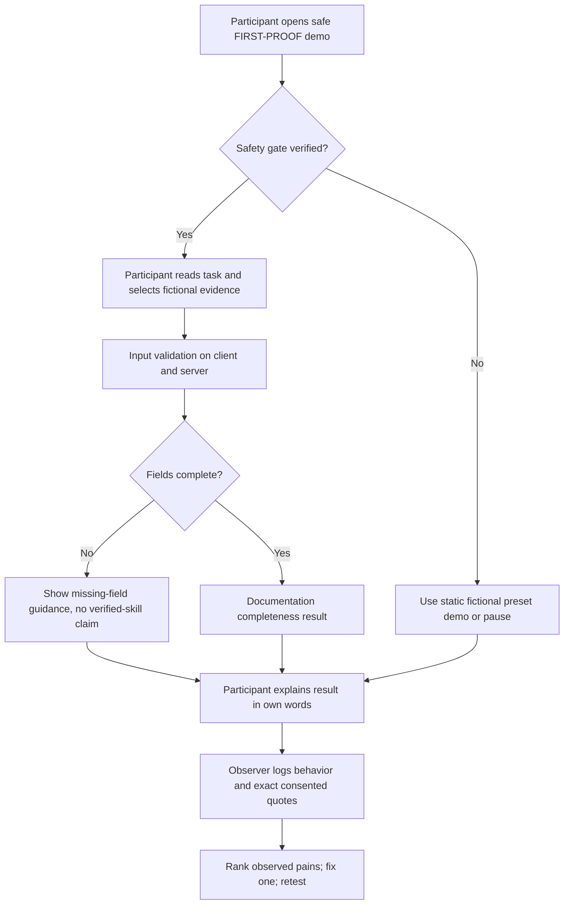
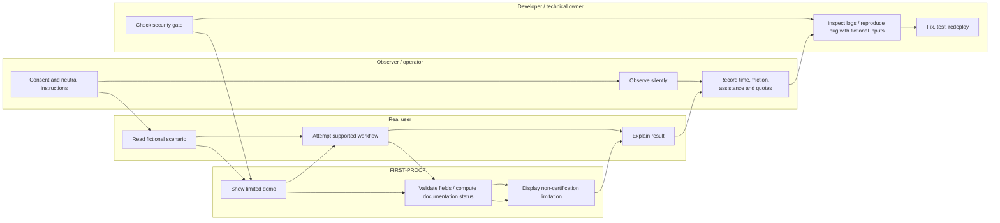

# FIRST-PROOF — WEEK 13 SHIP PACKET
**Venture:** FIRST-PROOF (ProofWaiver)  
**Student:** Sofía López  
**Module:** Business Bending, Week 13 — Real Humans: Five Users Who Don't Love You  
**Status:** Pre-code planning artifact. Proposed design; functionality is not claimed as deployed or verified.  
**Existing Week 12 URL:** https://first-proof-week12.vercel.app/

## 1. Problem in my words
Students applying for internships may be asked to demonstrate similar skills repeatedly. FIRST-PROOF is a prototype for recording the evidence a student says they have and checking whether required documentation fields are complete. But a complete record does **not** prove genuine proficiency, authenticity or employer recognition. The Week 13 problem is to learn whether users can complete the evidence workflow without assistance, interpret the result accurately and find a practical reason to use the tool rather than an existing folder, spreadsheet or portfolio.

## 2. Exact user
Primary: University students in Mexico applying to internships or entry-level roles who have experienced skills assessments, especially Excel-related ones. Recruit five real participants, including at least three strangers. Screen for experience with assessments, but separately label any participant whose feedback supports only usability rather than the original problem hypothesis. Collect only consented observations, using P1–P5 codes; do not collect real résumés or personal assessment records for classroom testing.

## 3. Success definition — before the module closes, X works
The existing FIRST-PROOF URL loads and the **safely permitted** demo flow allows a test participant to inspect fictional skills evidence, follow the submission/review workflow supported by the code, and interpret a result that unmistakably distinguishes **documentation completeness** from **verified skills or document authenticity**. The team will document five real user sessions (three strangers minimum), three ranked observed problems, the highest-priority verified fix, before/after evidence, and any real voluntary return signal. A failure to observe a return must be reported as such. The app will have an elementary analytics/feedback mechanism (privacy-minimizing event log or comparable mechanism), at least five genuine Git commits, two verified deploys, and a test–fix–redeploy cycle. Features not present in the repository are **not** assumed to work.

## 4. Image-generated mockup
See `assets/FIRST_PROOF_CONCEPT_MOCKUP.png` (generated before coding). It is a **design mockup, not a screenshot of a deployed feature**. The target message inside the primary result: **“Information complete — skills and authenticity not verified.”** Any proposed “Save draft” element is illustrative only; do not build it unless essential and safely testable.

## 5. Mermaid flowchart — main feature

## 6. Mermaid swimlane — responsibilities

## 7. Benchmark line — global to local
**Best existing model for trustworthy evidence provenance:** Europass European Digital Credentials for Learning, which uses institution-issued digital credentials; **FIRST-PROOF differs/localizes** by starting with simpler Spanish/English documentation-completeness guidance for Mexican university students, explicitly **without** claiming official issuance or verification. Source: https://europass.europa.eu/en/european-digital-credentials-learning

**Testing method benchmark:** UK Government Digital Service moderated usability testing; **FIRST-PROOF adapts** neutral, real-task observation to short, consented Mexican university sessions using fictional evidence. Source: https://www.gov.uk/service-manual/user-research/using-moderated-usability-testing

## 8. Three-sentence long view (light charter)
In three years, FIRST-PROOF could be a trusted place for students to organize skills evidence and understand exactly what has or has not been independently verified. If universities or employers eventually agree to collaborate, issuer-backed verification could be added as a separate, clearly labeled layer rather than inferred from completed fields. Growth would be gated by demonstrated user value, explicit consent, verified security and honest claims.

## 9. Scope cut — NOT building this week
No employer-accepted certification, automatic proof of Excel proficiency, issuer verification integrations, a new AI judge, a public credential marketplace, paid subscriptions, major UI redesign, or complex draft-saving system unless actual observed evidence makes a narrowly scoped change necessary and the current code safely supports it. No real-document intake until data handling, API/database permissions and upload controls are verified.

## 10. Architecture + stack table (existing configuration requires repository inspection)
| Layer | Existing / proposed | Verification needed |
| --- | --- | --- |
| Frontend | Existing deployed FIRST-PROOF web interface; Week 12 used Next.js | Inspect `package.json`, routes and build locally |
| Hosting | Existing Vercel URL | Confirm current deployment loads; verify two new deploys |
| Auth | Week 12 referenced Supabase Auth | Verify implemented provider and authentication paths; Google sign-in where personal data is stored per security floor |
| Database | Week 12 referenced Supabase | Check actual tables, RLS on user-owned data, direct API paths |
| Evaluation | Evidence/documentation result; algorithm not independently verified | Inspect source; test fixed completeness rules and truthful copy |
| Analytics / feedback | New minimum requirement | Implement simple privacy-minimizing event log; avoid names, submissions or secrets |
| QA | Mechanical tests + persona + actual real-user sessions | Maintain TEST_LOG with expected/observed results and evidence |

## 11. Test plan
### Security floor (before participant interaction)
1. Search repository and Git history for exposed secrets. Never publish real credentials; keep server keys in Vercel env vars only.  
2. If personal data is stored: verify authentication and Google sign-in where applicable.  
3. Verify Supabase RLS and direct account-isolation attempts across two test accounts and unauthenticated access; include relevant read/write paths.  
4. Validate all forms at input boundaries (type and length; server-side checks for state-changing requests).  
5. Ensure every demo/seed uses visibly labeled fictional data; prevent real personal document uploads if their protections are unverified.

### Mechanical pass — must be performed and logged
- URL loads; expected navigation works; fictional complete and incomplete records yield appropriate statuses.
- Wrong types, missing fields, oversized input and repeated submissions are handled safely.
- A user cannot force “complete” by a direct malformed API request; cross-account and unauthenticated access are denied in the tested paths.
- Error messages and logs do not echo invented private-looking test strings.
- Record **one actually observed bug** with before screenshot/log, implement the narrowest fix, rerun relevant plus regression tests, redeploy, preserve after proof.

### Synthetic Persona Test — separate fresh chat
- Use a fictional persona derived from the target-user hypothesis, not pretend it is a real user.
- Present **actual screenshots** of the deployed screens in order; never ask persona to assume invisible functions.
- Ask the persona to attempt the task, narrate uncertainty, and identify where they would stop.
- Record exact assistant responses, date, screens shown, and proposed fix; verify any correction on the actual site.

### Real user pass — five genuine people
- Consent, neutral task, no coaching; at least three strangers.
- Observe own-method comparator and FIRST-PROOF, if manageable; record completion, time, help, errors, comprehension and exact consented quotes.
- Rank top three **actual** pains by severity, frequency, threat to 10:1 advantage and feasible correction. Fix #1; retest before/after; record actual independent return if it occurs.

## 12. Build commitments and session close
- At least 5 meaningful commits and 2 deploys; never invent hashes, URLs, bugs or test passes.
- Every development session ends: update `docs/DECISIONS.md`, state tomorrow's first move, commit and push.
- Required final artifacts: live URL, GitHub link, `DEMO_Sofia_Lopez.mp4` (3 minutes + 30-sec reflection), `PACKET_Sofia_Lopez.pdf`, `PERSONA_Sofia_Lopez.pdf`, `BUILDCHAT_Sofia_Lopez.pdf` (raw development transcript).

## 13. Evidence status at packet creation
| Item | State |
| --- | --- |
| Week 12 deployment URL | Known from previous work; current availability not independently confirmed |
| Image-generated mockup | Prepared as concept only |
| Packet | Prepared BEFORE Week 13 code changes |
| Repository inspection, 5 commits, 2 deploys | Pending |
| Security checks and mechanical test | Pending |
| Bug observed/fixed/redeployed | Pending |
| Synthetic persona and five real users | Pending |
| Demo video and raw build transcript | Pending |
